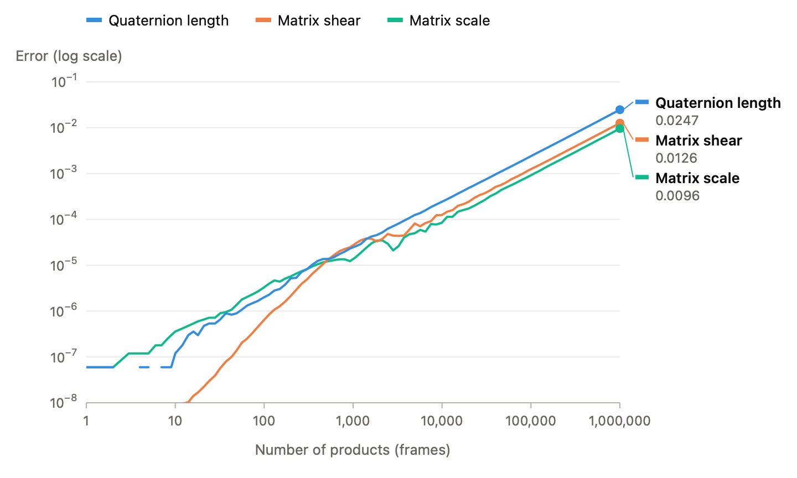

Affine matrices are the backbone of 3D virtual worlds. Every game engine, math library, and 3D piece of software includes support for them in one form or another. The primary reason for this is their flexibility: a single matrix can represent any combination of rotation, translation, scale, shear, and reflection. They can be composed through simple multiplication and their opposite transformation is achieved by inverting the matrix. However, that flexibility has a cost: a single representation for all of these means it cannot be optimal for each one and extracting a part from a whole can be quite difficult.

This post is part of the [Representing Affine Transforms series]().

## What an affine matrix looks like

An affine transform keeps straight lines straight and parallel lines parallel. Some affine transforms also preserve the lengths of segments and the angles between them (e.g. a rotation, a translation, or a reflection). A uniform scale keeps only the angles, and the other affine transforms preserve neither.

<video width="1280" height="720" autoplay loop muted playsinline poster="/public/transforms/affine_properties_poster.jpg" aria-label="An affine transform changes a square into a parallelogram">
  <source src="/public/transforms/affine_properties.mp4" type="video/mp4">
  <a href="/public/transforms/affine_properties.mp4">An affine transform changes a square into a parallelogram</a>
</video>

*An affine transform changes the grid and a square with sides of length 2. The lines of the grid stay straight and parallel, but the lengths of the sides and the angle between them change.*

In 3D, an affine transform is represented by a 3x3 linear part `A` and a translation `t`:

```
p' = p * A + t
```

To write this as one matrix product, we add a fourth component `w` to each 3D point. A 3D point has `w = 1` and a 3D direction has `w = 0`. This fourth dimension allows us to store the transform as a 4x4 matrix with the translation in the last row:

```
              | a00 a01 a02 0 |
[x y z w]  *  | a10 a11 a12 0 |
              | a20 a21 a22 0 |
              | t0  t1  t2  1 |
```

The last column is always `[0, 0, 0, 1]`. Thus RTM stores only the first three columns, and calls the type `matrix3x4f`. Each row of the 3x3 part is the image of one axis: the first row is where the X axis goes. The 4x4 type (`matrix4x4f`) is for projections, which are not affine.

## The parts of an affine matrix

Before we look at a matrix that holds everything, we look at each part alone. Each video below applies one part to a square with sides of length 2, in 2D. In 2D, the matrix is 3x3: a 2x2 linear part, and the translation in the last row. The blue row is the image of the X axis, and the orange row is the image of the Y axis. A 3D matrix has the same form, with one more row and one more column.

### Scale

A scale multiplies each axis by one value. The scale values are on the diagonal:

```
| sx 0  0  0 |
| 0  sy 0  0 |
| 0  0  sz 0 |
| 0  0  0  1 |
```

<video width="1280" height="720" autoplay loop muted playsinline poster="/public/transforms/matrix_scale_poster.jpg" aria-label="A scale matrix changes the length of each axis">
  <source src="/public/transforms/matrix_scale.mp4" type="video/mp4">
  <a href="/public/transforms/matrix_scale.mp4">A scale matrix changes the length of each axis</a>
</video>

*A scale of `[1.5, 0.75]` multiplies the length of the X axis by 1.5 and the length of the Y axis by 0.75. Only the diagonal of the matrix changes, and the axes stay orthogonal.*

When `sx`, `sy`, and `sz` are equal, the scale is uniform, and it preserves every angle. A negative value is a reflection along that axis. The determinant `sx * sy * sz` is the change in volume.

### Rotation

A rotation preserves the lengths of segments and the angles between them. The rows of a rotation matrix are orthogonal to each other, and each row has a length of 1. A rotation by an angle `a` about the Z axis is:

```
|  cos(a) sin(a) 0 0 |
| -sin(a) cos(a) 0 0 |
|  0      0      1 0 |
|  0      0      0 1 |
```

<video width="1280" height="720" autoplay loop muted playsinline poster="/public/transforms/matrix_rotation_poster.jpg" aria-label="A rotation matrix turns the two axes together">
  <source src="/public/transforms/matrix_rotation.mp4" type="video/mp4">
  <a href="/public/transforms/matrix_rotation.mp4">A rotation matrix turns the two axes together</a>
</video>

*A rotation by 30 degrees turns the two axes together (preserving the angle between them). The four values of the 2x2 part change, but the rows stay orthogonal, and their length stays 1.*

A rotation about the X axis or the Y axis has the same form, in the two other rows and columns. A general rotation uses all 9 values of the 3x3 part, but it has only 3 degrees of freedom. Its determinant is 1, and its inverse is its transpose.

### Shear

A shear moves each point parallel to one axis, by a distance that is proportional to its coordinate on another axis. In 2D, a shear along X by a factor `k` is:

```
         | 1 0 |
p' = p * | k 1 |      ->      x' = x + k * y,   y' = y
```

A unit square becomes a parallelogram. The bottom edge (y = 0) does not move, and the top edge (y = 1) moves by `k`. The area does not change (the determinant of a shear matrix is 1).

<video width="1280" height="720" autoplay loop muted playsinline poster="/public/transforms/matrix_shear_poster.jpg" aria-label="A shear matrix moves the Y axis parallel to the X axis">
  <source src="/public/transforms/matrix_shear.mp4" type="video/mp4">
  <a href="/public/transforms/matrix_shear.mp4">A shear matrix moves the Y axis parallel to the X axis</a>
</video>

*A shear along X by 0.75 moves each point by 0.75 times its Y coordinate. The X axis does not move, and the Y axis leans to the right. The rows of the matrix are not orthogonal, but the area of the square does not change.*

In 3D, a shear matrix is the identity with one or more values off the diagonal. A general 3x3 matrix has 9 degrees of freedom: 3 for the rotation, 3 for the scale, and 3 for the shear. The rows of a matrix that has no shear are orthogonal to each other. The rows of a matrix with shear are not. This is a key point: **shear is the part of a matrix that makes its axes not orthogonal.**

### Translation

The translation is in the last row:

```
| 1  0  0  0 |
| 0  1  0  0 |
| 0  0  1  0 |
| t0 t1 t2 1 |
```

<video width="1280" height="720" autoplay loop muted playsinline poster="/public/transforms/matrix_translation_poster.jpg" aria-label="A translation matrix moves the square, and the axes do not change">
  <source src="/public/transforms/matrix_translation.mp4" type="video/mp4">
  <a href="/public/transforms/matrix_translation.mp4">A translation matrix moves the square, and the axes do not change</a>
</video>

*A translation by `[1.5, 1]` moves the square, but the axes keep their length and their direction. Only the last row of the matrix changes.*

A 3D point has `w = 1`, thus it moves by `t`. A 3D direction has `w = 0`, thus the translation does not change it (the product multiplies the last row of the matrix by zero, which removes its contribution). The inverse of a translation is a simple negation: `-t`.

### All the parts together

A matrix that has all the parts is the product of these matrices. With row vectors, a product applies the transforms from left to right. Thus `S * R * T` applies the scale first, then the rotation, and then the translation. The translation stays alone in the last row, but the 3x3 part mixes the scale, the rotation, and the shear.

Of the four parts, shear causes the most problems. The next sections show where it comes from, and why it matters.

## Rotation as a series of shears

A shear and a rotation appear to be very different, but a rotation is a product of shears. In 2D, three shears give a rotation by an angle `a` (Alan Paeth, *A Fast Algorithm for General Raster Rotation*, 1986). With column vectors, as in the paper:

```
X(k) = | 1 k |      Y(k) = | 1 0 |
       | 0 1 |             | k 1 |

R(a) = X(-tan(a/2)) * Y(sin(a)) * X(-tan(a/2))
```

The product of the three matrices is exactly `[cos(a), -sin(a); sin(a), cos(a)]`. Paeth used this to rotate images: a shear moves each row (or column) of pixels by an offset, and each pass needs no interpolation in two dimensions. Note that `tan(a/2)` goes to infinity at 180 degrees. For a large angle, rotate by 180 degrees first (a negation of the two axes) and then by the remainder.

In 3D, the same idea applies. A 3D rotation is a product of three rotations about the axes, and each one is three shears, as in 2D: nine shears in total. Two neighbor shears can merge into one, which gives eight. Baoquan Chen and Arie Kaufman show that four shears are sufficient for any 3D rotation (*3D Volume Rotation Using Shear Transformations*, 2000). Each of their shears is a 2D beam shear: it moves one coordinate by an amount that depends on the two other coordinates, for example `x' = x + a * y + b * z`. Its matrix is the identity with two values off the diagonal. More generally, the shear matrices generate all the matrices with a determinant of 1.

Why does this matter? Because it shows that a rotation and a shear are not separate in a matrix. A matrix does not know which parts are rotation and which parts are shear. The values are only 9 numbers.

## A rotation and a non-uniform scale create shear

A rotation has no shear, and a scale has no shear. But combined together, they can induce shear.

Let `S = diag(sx, sy, sz)` be a scale and `R` a rotation. With row vectors, `S * R` applies the scale first, then the rotation. Each row of `S * R` is one row of `R` multiplied by one scale value: `sx * row0(R)`, `sy * row1(R)`, and `sz * row2(R)`. The rows of `R` are orthogonal, thus the rows of `S * R` are also orthogonal. This matrix has no shear: it is a box with a rotation.

`R * S` applies the rotation first, then the scale along the fixed X, Y, and Z axes. Now each value of the scale multiplies one column of `R`, not one row. In general, the rows of the result are not orthogonal, thus the matrix has shear.

A 2D example makes this concrete. Take a rotation of 45 degrees and a scale of `[1, 2]`. The rows of `R * S` are `[0.7071, 1.4142]` and `[-0.7071, 1.4142]`. Their dot product is 1.5, not 0, and the angle between them is 53 degrees, not 90 degrees. A square becomes a rhombus:

<video width="1280" height="720" autoplay loop muted playsinline poster="/public/transforms/non_uniform_scale_shear_poster.jpg" aria-label="A non-uniform scale after a rotation creates shear">
  <source src="/public/transforms/non_uniform_scale_shear.mp4" type="video/mp4">
  <a href="/public/transforms/non_uniform_scale_shear.mp4">A non-uniform scale after a rotation creates shear</a>
</video>

*The left side scales a square by `[1, 2]` and then rotates it by 45 degrees: the result is a rectangle with a rotation, and its corner stays at 90 degrees. The right side rotates the square first and then scales it: the result is a rhombus, and its corner becomes 53 degrees.*

We can also write the product with the rotation at the end:

```
R * S = (R * S * R^T) * R
```

The matrix `R * S * R^T` is the scale `S` along the axes of the rotation. It is symmetric, but it is not diagonal: it holds a scale and a shear. In the example above, it is `[1.5, 0.5; 0.5, 1.5]`.

With a uniform scale, the order does not matter, because a scalar commutes with a rotation. The post about VQ and VQS uses this property.

This case is common in a hierarchy: a child with a rotation, under a parent with a non-uniform scale. The product of the two transforms applies the rotation of the child first, then the scale of the parent, inducing shear in the process. A matrix holds that shear with no problem. The post about VQV shows a type that cannot.

## Translation as a shear in a higher dimension

This choice to add a fourth dimension to represent a 3D transformation may seem odd. Where does it come from, and why? The answer is simple: a translation in N dimensions can be represented as a shear in N+1 dimensions.

Look again at the 4x4 matrix of a pure translation, in the [Translation](#translation) section above. This matrix is the identity with three values off the diagonal: it is a 4D shear. It moves each point parallel to the XYZ space, by a distance that is proportional to its `w` coordinate. A point has `w = 1`, thus it moves by `t`. A direction has `w = 0`, thus it does not move. The 3D space of points is the slice `w = 1` of the 4D space, and the shear slides that slice without a change in its shape.

We cannot draw a 4D space, but the same idea works one dimension lower. A 2D translation is a shear of the 3D space with the coordinates `x`, `y`, and `w`:

```
| 1  0  0 |
| 0  1  0 |
| t0 t1 1 |
```

<video width="1280" height="720" autoplay loop muted playsinline poster="/public/transforms/translation_shear_poster.jpg" aria-label="A 2D translation as a shear of the 3D space">
  <source src="/public/transforms/translation_shear.mp4" type="video/mp4">
  <a href="/public/transforms/translation_shear.mp4">A 2D translation as a shear of the 3D space</a>
</video>

*The shear moves each point by `w * t`. The plane `w = 0` and the directions in it do not move. The plane `w = 1` slides by `t`: for the 2D points in that plane, the shear is a translation. The slice `w = 0.5` moves by `t / 2`.*

This is the reason for the fourth component `w` (which is also called the homogeneous coordinate). A linear transform always maps the origin to the origin, thus a 3x3 matrix cannot move a point (through a translation). In 4D, the translation is linear: it is a shear. Thus a 4x4 matrix can hold the linear part and the translation together, and one matrix product applies both.

## Numerical drift

With floating point arithmetic, each multiplication of two matrices incurs rounding for each value. In a long chain of products, the errors accumulate. For a pure rotation, the result must have orthogonal rows of unit length. After many products, it does not.

As a test, I multiplied a small rotation with itself 1,000,000 times with `float32`, as a matrix and as a quaternion:

| After 1,000,000 products | Length of X axis | Length of Y axis | dot(X, Y) |
| ------------------------ | ---------------- | ---------------- | --------- |
| `matrix3x4f`             | 1.002211         | 1.006470         | 0.006936  |

The test is a loop of products with RTM. The rotation of each step is about 0.1 degree:

```c++
const quatf step = quat_from_euler(0.001F, 0.0013F, 0.0007F);
const matrix3x4f step_mtx = matrix_from_quat(step);

matrix3x4f mtx = matrix_identity();
quatf quat = quat_identity();

for (int i = 0; i < 1000000; ++i)
{
    mtx = matrix_mul(mtx, step_mtx);
    quat = quat_mul(quat, step);
}
```

This represents an object that turns a small amount each frame, when the code accumulates its transform frame after frame. At 60 frames per second, 1,000,000 frames is about **4.6 hours**. The error grows with the number of products:

{: width="720" height="432"}

*Matrix scale: the largest difference between the length of an axis and 1. Matrix shear: the largest dot product of two axes. Quaternion length: the difference between the length of the quaternion and 1. The two axes of the chart use a log scale.*

After about 10,000 products, each error grows in proportion to the number of products: 100 times more products give about 100 times more error.

The quaternion also drifts, and its error is larger: its length is **0.975255** after the same products. But the form of the error is different, and this is what matters. A quaternion has only 4 values. Any quaternion that is not zero maps to exactly one rotation when we normalize it, and a normalization is cheap. The quaternion cannot represent shear.

The matrix has 9 values, and its error is a mix of scale (the lengths are not 1) and shear (the dot product is not 0). To correct it, we must make the rows orthogonal again, for example with the Gram-Schmidt process. That process is more expensive than a normalization, and it is not symmetric: it keeps the direction of the first axis and moves the two others. A different order of the axes gives a different result.

## A matrix does not interpolate

Animation needs interpolation between two keys. A linear interpolation of two matrices interpolates each of the 12 values. For the translation, this is correct. For the 3x3 part, it is not.

Take the identity and a rotation of 90 degrees about Z. What happens halfway? The X axis is the average of `[1, 0, 0]` and `[0, 1, 0]`: `[0.5, 0.5, 0]`. Its length is 0.7071, not 1. The result points in the correct direction, but it also has a scale of 0.7071. For a rotation of 180 degrees about Z, the X and Y axes of the halfway matrix have a length of zero, and the matrix collapses the object onto the Z axis.

To interpolate a matrix correctly, we must decompose it into parts that interpolate (a rotation, a scale, a translation), interpolate each part, and then build a new matrix from them. Ken Shoemake and Tom Duff describe such a decomposition (*Matrix Animation and Polar Decomposition*, 1992). But a decomposition has two problems:

* It is expensive. The polar decomposition needs an iterative algorithm.
* It is not unique. A matrix with a negative determinant has a reflection, but we cannot know which axis it was on: a reflection of two axes is the same as a rotation of 180 degrees. If two keys decompose in a different way, the interpolation between them is wrong.

## Strengths and drawbacks

### Strengths

* **It holds everything.** Rotation, uniform and non-uniform scale, shear, reflection, and translation all fit in the same 12 values.
* **It forms a group.** The product of two affine matrices is an affine matrix, the product is associative, and each matrix with a determinant that is not zero has an exact inverse. Nothing is lost when we multiply a hierarchy of transforms.
* **It is fast to apply.** A point transform is 3 multiplications and 3 additions per component. With SIMD, it is 3 broadcasts and 3 FMA instructions for the full point. This is why skinning code typically converts the joint transforms to matrices before transforming vertices.
* **The hardware and the APIs expect it.** Shaders, physics engines, and file formats exchange matrices.

### Drawbacks

* **It is large.** 12 floats (48 bytes) for 3x4, and 16 floats (64 bytes) for 4x4. A rotation has 3 degrees of freedom, but the matrix uses 9 values for it (upper 3x3 part).
* **It mixes the parts.** The 3x3 part holds the rotation, the scale, and the shear together. To find them again, we must decompose the matrix, and the result is not unique.
* **It drifts.** Rounding errors move the 3x3 part away from a pure rotation, and the error takes the form of scale and shear. A series of pure rotations can induce shear through rounding error.
* **It does not interpolate.** A linear interpolation of two rotation matrices is not a rotation matrix.

As the sections above show, the last three drawbacks are all about shear.

## Conclusion

The affine matrix is the general solution. It loses nothing when we multiply or invert it, and it is the most hardware-friendly format. But it does not interpolate, it drifts into shear, and its parts are difficult to find again. For this reason, it is generally best to keep the parts apart, and build a matrix only at the end, to transform the vertices.

In the next posts, we look at the types that keep the parts apart. The next post starts with the simplest: a quaternion and a translation.

## References

* Alan W. Paeth, *A Fast Algorithm for General Raster Rotation*, Graphics Interface 1986
* Baoquan Chen and Arie Kaufman, *3D Volume Rotation Using Shear Transformations*, Graphical Models 62(4), 2000, pages 308-322, [doi:10.1006/gmod.2000.0525](https://doi.org/10.1006/gmod.2000.0525)
* Ken Shoemake and Tom Duff, *Matrix Animation and Polar Decomposition*, Graphics Interface 1992
* [RTM: types supported](https://github.com/nfrechette/rtm/blob/develop/docs/types_supported.md)
